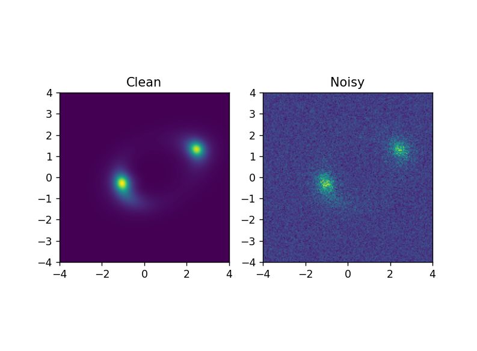

# Olin

**Olin** is a scientific machine-learning project exploring **inverse inference in strong gravitational lensing**.

The project investigates whether a computer-vision model can infer physical lens parameters from simulated astronomical observations generated from an explicit gravitational-lensing forward model.

> **Physical parameters → gravitational lensing → synthetic observation → CNN inference → physics-based reconstruction**

Olin is designed as a first-principles scientific software project rather than a generic image-classification application. The goal is to connect established gravitational-lensing physics with a complete machine-learning inference pipeline.

## Project Status

**Early development — forward model and baseline inverse inference**

Current progress:

- First-principles gravitational-lensing sandbox
- Point-mass lensing
- Extended-source modelling
- Distributed-mass lensing experiments
- Singular Isothermal Ellipsoid (SIE) lens model
- Sérsic source model
- External shear
- PSF-based observation modelling
- Photon-counting and detector-noise simulation
- FM1 forward model
- Synthetic dataset generation pipeline
- 10,000-sample synthetic dataset
- Train/validation/test preparation pipeline
- CNN₀ Einstein-radius regression baseline
- Baseline evaluation and prediction analysis
- Improved training control / CNN₁
- Uncertainty estimation
- Degeneracy and generalization experiments
- Real-observation validation
- FM2 inference/reconstruction model
- Web application and scientific reporting

The current milestone establishes a complete controlled synthetic-data → machine-learning baseline. Later development will increase the physical and statistical complexity of the inverse problem.

## Scientific Objective

Gravitational lensing is a forward physical process: the mass distribution of a foreground lens alters the apparent light distribution of a background source.

Olin approaches the inverse problem:

> **Given an observed lensed image, can a machine-learning model infer the physical parameters that generated it?**

The initial experiment focuses on estimating the **Einstein radius** $\theta_E$ as a continuous regression target.

The first controlled dataset varies only $\theta_E$, while the remaining lens, source, and observation parameters are held fixed. This isolates the relationship between Einstein radius and image morphology before introducing additional sources of ambiguity.

## Forward Model

The production forward model uses established gravitational-lensing models implemented with `lenstronomy`.
```text
Lens parameters
      +
Source parameters
      ↓
Gravitational lensing
      ↓
Ideal lensed image
      ↓
Observation / instrument effects
      ↓
Photon-counting noise
      ↓
Detector read noise
      ↓
Synthetic observation
```

The current lens model combines:

- Singular Isothermal Ellipsoid (SIE)
- External shear

The background source is represented using an elliptical Sérsic profile.

The controlled observation layer currently includes:

- fixed pixel scale
- fixed image field of view
- Gaussian PSF
- photon-counting noise
- Gaussian detector read noise

The observation model is intentionally controlled rather than a complete telescope or detector simulator.

### Example observation

The forward model produces an ideal lensed image and then applies the controlled observation model to obtain a noisy synthetic observation.



## Machine-Learning Pipeline

The current inverse-inference pipeline begins with the synthetic observation and predicts the Einstein radius:
```text
Synthetic observation
        ↓
       CNN₀
        ↓
 Predicted θ_E
```

The planned complete pipeline extends this with a separate inference/reconstruction forward model:
```text
Synthetic observation
        ↓
       CNN
        ↓
 Predicted physical parameters
        ↓
      FM2
        ↓
Physics-based reconstruction
        ↓
Comparison with observation
```

The reconstruction stage is intended as a physics-based validation step rather than an image-enhancement or denoising operation.

## Synthetic Dataset

Synthetic data is used as the initial training foundation because the forward model provides exact ground-truth parameters.

### Dataset V0

The first large-scale dataset contains **10,000 synthetic observations**.

| Parameter                 | V0                         |
| ------------------------- | -------------------------- |
| Target                    | Einstein radius $\theta_E$ |
| $\theta_E$ range          | 1.6″ – 2.8″                |
| Image size                | 160 × 160                  |
| Pixel scale               | 0.05″ / pixel              |
| Field of view             | 8″ × 8″                    |
| Lens model                | SIE + external shear       |
| Source model              | Elliptical Sérsic          |
| PSF                       | Gaussian                   |
| Dataset size              | 10,000 observations        |
| Train / validation / test | 8,000 / 1,000 / 1,000      |

The initial $\theta_E$ range was selected after visually examining generated observations and ensuring that the lensing structure remained sufficiently distinguishable for the controlled V0 experiment.

The generated dataset and prepared NumPy arrays are excluded from version control because they are derived artifacts rather than source code.

The local dataset structure is:
```text
datasets/
└── dataset_v0/
    ├── images/
    │   ├── 000001.npy
    │   ├── 000002.npy
    │   └── ...
    ├── labels.csv
    └── metadata.json
```

Prepared training arrays are also generated locally:
```text
datasets/
├── x_train_0.npy
├── y_train_0.npy
├── x_validation_0.npy
├── y_validation_0.npy
├── x_test_0.npy
└── y_test_0.npy
```

## CNN₀ Baseline

CNN₀ is the first machine-learning baseline for continuous Einstein-radius regression.

### Architecture
```text
160 × 160 × 1
      ↓
Conv2D — 16 filters, 3×3, ReLU
      ↓
MaxPooling — 2×2
      ↓
Conv2D — 32 filters, 3×3, ReLU
      ↓
MaxPooling — 2×2
      ↓
Flatten
      ↓
Dense — 64, ReLU
      ↓
Dense — 1
      ↓
Predicted θ_E
```

The model contains approximately **2.96 million trainable parameters**.

### Training configuration

| Setting     | CNN₀                                       |
| ----------- | ------------------------------------------ |
| Optimizer   | Adam                                       |
| Loss        | Mean Squared Error (MSE)                   |
| Metric      | Mean Absolute Error (MAE)                  |
| Epochs      | 10                                         |
| Batch size  | 32                                         |
| Random seed | 42                                         |
| Input       | Normalized 160 × 160 grayscale observation |
| Target      | $\theta_E$                                 |

The normalization statistics are calculated from the training split and then applied unchanged to the validation and test splits.

## CNN₀ Results

CNN₀ successfully learned a strong relationship between the synthetic observations and Einstein radius during the early stages of training.

The best validation MAE occurred at **epoch 2**:

> **Validation MAE: 0.0193″**

However, under the fixed 10-epoch training schedule, validation error subsequently increased substantially. The final epoch produced:

| Metric         | Final value |
| -------------- | ----------- |
| Training MAE   | 0.0771″     |
| Validation MAE | 0.1127″     |
| Test MAE       | **0.1114″** |
| Test MSE       | **0.01388** |

The behaviour indicates that the baseline model can learn the controlled inverse relationship, while the fixed training schedule allows performance to deteriorate after the early epochs.

This is treated as a **baseline observation rather than a final model**. Future model versions will investigate improved training control and more scientifically challenging inference settings.

The trained CNN₀ artifact is kept locally and is intentionally **not stored in the Git repository**.

## Dataset → Model Workflow

The current reproducible workflow is:
```text
Physical parameters
        ↓
       FM1
        ↓
10,000 synthetic observations
        ↓
Dataset preparation
        ↓
Train / validation / test split
        ↓
Normalization
        ↓
      CNN₀
        ↓
Einstein-radius prediction
        ↓
Evaluation
```

The repository stores the code required to reproduce these stages, while generated datasets and trained model artifacts remain local.

## Repository Structure
```text
Olin/
│
├── assets/
│   └── dataset_v0_sample.png
│
├── FM1/
│   ├── dataset_generation_forward_model.py
│   ├── generate_dataset.py
│   └── README.md
│
├── simulation/
│   ├── point_mass.py
│   ├── einstein_ring.py
│   ├── extended_source.py
│   ├── distributed_mass.py
│   ├── sie.py
│   └── sersic.py
│
├── training/
│   ├── prepare_dataset.py
│   └── train_cnn_0.py
│
├── datasets/                  # generated locally, not tracked
│
├── Documents and updations/
│   └── Olin_scientific_sw_report.pdf
│
├── README.md
└── .gitignore
```

### FM1

**FM1** is the dataset-generation forward-model side of Olin.

It converts physical lens/source parameters into synthetic observations and provides the simulation interface used by the dataset-generation script.

### Simulation

The `simulation/` directory contains first-principles exploratory implementations developed to understand the underlying physics before moving to the production modelling layer.

These experiments include point-mass lensing, distributed-mass lensing, SIE, and Sérsic source modelling.

They are primarily educational and exploratory rather than the final production pipeline.

### Training

The `training/` directory contains the machine-learning data-preparation and baseline-training pipeline.

- `prepare_dataset.py` loads the generated dataset, creates the train/validation/test split, calculates training-set normalization statistics, and saves prepared arrays.
- `train_cnn_0.py` loads the prepared arrays, trains CNN₀, evaluates it, and saves the local model artifact.

## Scientific Design Principles

Olin follows several principles:

1. **Physics before ML**
   The physical forward process is established before training the inverse model.
2. **Controlled experiments**
   Initial datasets vary one important parameter at a time so that model behaviour can be interpreted.
3. **Known ground truth**
   Synthetic observations provide exact physical parameters for quantitative evaluation.
4. **Physics-based validation**
   Predicted parameters are intended to be passed through a separate inference/reconstruction forward model.
5. **Progressive complexity**
   Additional physical variation, noise, uncertainty, and parameter degeneracies will be introduced only after the baseline experiment is understood.
6. **Depth over feature count**
   The project prioritizes improving the scientific inference pipeline rather than adding unrelated application features.
7. **No claims of novel cosmological physics**
   Olin uses established gravitational-lensing physics as the scientific foundation for investigating an inverse machine-learning problem.

## Future Directions

Planned extensions include:

- improved CNN training and model baselines
- uncertainty estimation
- parameter-wise evaluation
- controlled lens/source variation
- lens-parameter degeneracy experiments
- out-of-distribution testing
- real astronomical observation validation
- FM2 inference/reconstruction model
- physics-based reconstruction and residual analysis
- scientific PDF reporting
- deployment through the Olin web application

Future experiments will focus on increasing the difficulty and scientific realism of the inverse problem rather than simply increasing model complexity.

## Technologies

- Python
- NumPy
- Matplotlib
- `lenstronomy`
- TensorFlow / Keras
- FastAPI *(planned)*
- PostgreSQL *(planned)*
- Vanilla HTML/CSS/JavaScript *(planned)*

## Documentation

The scientific software requirements and architecture are documented in:

`Documents and updations/Olin_scientific_sw_report.pdf`

## References

### Gravitational-lensing modelling

1. Birrer, S., & Amara, A. (2018). *lenstronomy: Multi-purpose gravitational lens modelling software package*. **Physics of the Dark Universe, 22**, 189–201.
   DOI: `10.1016/j.dark.2018.11.002`
2. Birrer, S., et al. (2021). *lenstronomy II: A gravitational lensing software ecosystem*. **Journal of Open Source Software**.
3. Birrer, S. (2024). *Strong gravitational lensing's 'external shear' is not shear*. **Monthly Notices of the Royal Astronomical Society**.

The `lenstronomy` documentation recommends citing the relevant software publications when using the package in scientific work.

### Software

- `lenstronomy` — open-source Python software for modelling strong gravitational lenses and performing forward modelling of lens mass and surface-brightness distributions.
