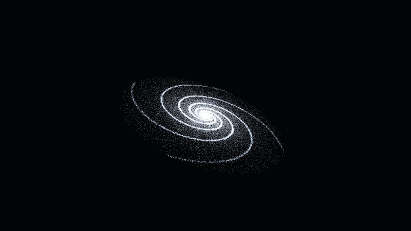
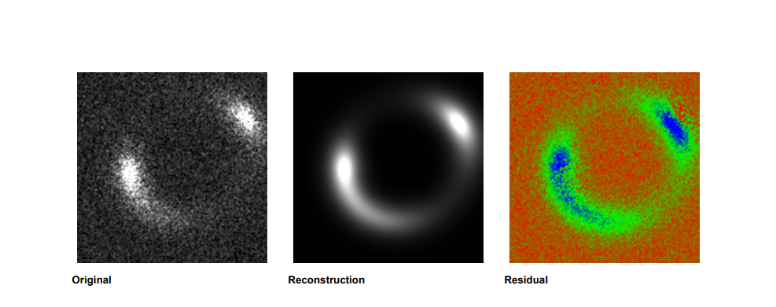

# Olin

**Olin** is a scientific machine-learning application exploring **inverse inference in strong gravitational lensing**.

The project investigates whether a computer-vision model can infer selected physical lens parameters from astronomical observations and examine those estimates through an established gravitational-lensing forward model.



> **Physical parameters → Gravitational lensing → Synthetic observation → Deep-learning inference → Physics-based reconstruction**

Olin connects gravitational-lensing physics with a machine-learning inference pipeline and an integrated web application for analysing compatible astronomical images.

## Project Status

**Olin V1 — Core Scientific Pipeline, Integrated Web Application and Local Docker Deployment Implemented**

The first complete application version brings together the scientific inference pipeline, authenticated user workflows, analysis visualisation, PDF reporting, and containerised local deployment.

### Completed

- First-principles gravitational-lensing experiments.
- Singular Isothermal Ellipsoid (SIE) lens modelling.
- Elliptical Sérsic source modelling.
- External shear.
- PSF-based observation modelling.
- Photon-counting and detector read-noise simulation.
- FM1 synthetic observation generation.
- Synthetic dataset generation and preparation.
- CNN₀ and CNN₁ Einstein-radius regression experiments.
- Multi-output physical parameter inference.
- V3 ResNet-18 model for five-parameter inference.
- Monte Carlo dropout uncertainty estimation.
- Uncertainty calibration using synthetic validation data.
- FM2 physics-based reconstruction.
- Residual generation and analysis.
- Exploratory testing using a real astronomical observation.
- FastAPI backend and PostgreSQL integration.
- User authentication and account workflows.
- Image upload and analysis creation.
- Analysis history and individual analysis viewing.
- Prediction and uncertainty presentation.
- Reconstruction and residual visualisation.
- Scientific PDF report generation and retrieval.
- Integrated frontend and backend workflow.
- Docker containerisation of the API and PostgreSQL database.
- Persistent Docker storage for database records, model cache and private application files.
- Local end-to-end verification of the Dockerised inference and reporting workflow.

### Current Research Directions

- Evaluation on a broader range of real astronomical observations.
- Further scientific validation and model generalisation experiments.
- Additional parameter-degeneracy and out-of-distribution studies.
- Improved uncertainty evaluation under observational distribution shift.

## Scientific Objective

Gravitational lensing is a physical process in which the gravitational field of a foreground mass changes the path followed by light from a more distant source.

Olin approaches the inverse problem:

> Given an observed gravitationally lensed image, can a machine-learning model estimate selected physical parameters of the lens system?

The forward problem starts with known physical parameters and generates an observation. The inverse problem attempts to recover selected parameters from that observation.

The gravitational lens equation is:

$
\boldsymbol{\beta}
=
\boldsymbol{\theta}
-
\boldsymbol{\alpha}(\boldsymbol{\theta})
$

where:

- $\boldsymbol{\beta}$ represents the source-plane position.
- $\boldsymbol{\theta}$ represents the image-plane position.
- $\boldsymbol{\alpha}(\boldsymbol{\theta})$ represents the deflection angle.

The inverse problem is challenging because different physical configurations can produce similar observed image structures. Olin investigates a constrained version of this problem using supervised deep learning and physics-based reconstruction.

## Forward Model — FM1

The production forward model uses established gravitational-lensing implementations from `lenstronomy`.

The lens model combines:

- Singular Isothermal Ellipsoid (SIE).
- External shear.

The background source is represented by an elliptical Sérsic profile.

The observation pipeline follows:

```text
Lens parameters
     +
Source parameters
     ↓
Gravitational lensing
     ↓
Ideal lensed image
     ↓
PSF convolution
     ↓
Photon-counting noise
     ↓
Detector read noise
     ↓
Synthetic observation
```

The controlled observation model includes:

- Image size: 160 × 160 pixels.
- Pixel scale: 0.05 arcseconds per pixel.
- Field of view: 8 × 8 arcseconds.
- Gaussian PSF with 0.4 arcsecond FWHM.
- Photon-counting noise.
- Gaussian detector read noise.

The observation model is intentionally controlled. It is not intended to represent every instrumental or observational effect present in real astronomical data.

## Synthetic Datasets

Synthetic observations provide known ground-truth parameters, making controlled quantitative evaluation possible.

### Dataset V0

The initial dataset was designed to isolate the relationship between Einstein radius and image morphology.

| Parameter | Configuration |
|---|---|
| Prediction target | Einstein radius ($\theta_E$) |
| Einstein-radius range | 1.6–2.8 arcseconds |
| Image size | 160 × 160 |
| Pixel scale | 0.05 arcseconds/pixel |
| Field of view | 8 × 8 arcseconds |
| Lens model | SIE + external shear |
| Source model | Elliptical Sérsic |
| Dataset size | 10,000 |
| Train / validation / test | 8,000 / 1,000 / 1,000 |
| Random seed | 42 |

### Dataset V1

Dataset V1 introduces additional physical variation to make the inverse problem more challenging.

The dataset contains 10,000 synthetic observations and includes variation in:

- Einstein radius.
- Lens ellipticity components.
- External shear components.
- Lens centre coordinates.
- Sérsic source properties.

The expanded dataset supports multi-parameter inference rather than restricting the model to a single regression target.

Generated datasets and prepared training arrays are excluded from version control.

## Machine-Learning Experiments

Olin was developed through successive experiments, beginning with a controlled single-parameter baseline and progressing towards multi-parameter inference.

### CNN₀ — Initial Baseline

CNN₀ was developed for continuous Einstein-radius regression.

Its architecture consists of convolutional layers, max-pooling, and dense regression layers.

The initial experiment demonstrated that a CNN could learn the relationship between the controlled synthetic observations and the Einstein radius.

However, its fixed training schedule allowed validation performance to deteriorate after the early epochs.

**Test results:**

| Metric | Result |
|---|---:|
| Test MAE | 0.111396 arcseconds |
| Test MSE | 0.01388 |

CNN₀ served as the initial baseline for subsequent training improvements.

### CNN₁ — Improved Training

CNN₁ introduced improved training control and early stopping.

| Metric | Result |
|---|---:|
| CNN₀ test MAE | 0.111396 |
| CNN₁ test MAE | 0.019245 |
| Best validation MAE | 0.018489 |
| Best epoch | 9 |

CNN₁ reduced test MAE by approximately **82.7%** relative to CNN₀.

This experiment established the importance of training control before increasing model complexity.

### V2 — Multi-output Inference

V2 extended the prediction task to five physical parameters:

- Einstein radius ($\theta_E$).
- Lens ellipticity ($e_1$, $e_2$).
- External shear ($\gamma_1$, $\gamma_2$).

Rather than training five independent models, V2 explored a shared multi-output architecture.

### V3 — ResNet-18

V3 uses a ResNet-18 architecture for multi-parameter inference.

The model predicts five selected physical parameters from a normalised grayscale observation.

The architecture uses a shared convolutional feature extractor followed by a global average pooling layer and a shared dense representation. Three output heads produce the Einstein radius, ellipticity components and shear components.

**Training configuration:**

| Setting | Value |
|---|---|
| Architecture | ResNet-18 |
| Epochs | 40 |
| Batch size | 32 |
| Initial learning rate | 0.001 |
| Prediction targets | 5 |
| Uncertainty passes | 30 |

**Held-out synthetic test results:**

| Parameter | MAE | R² |
|---|---:|---:|
| $\theta_E$ | 0.034362 | 0.983177 |
| $e_1$ | 0.036626 | 0.882142 |
| $e_2$ | 0.036234 | 0.877282 |
| $\gamma_1$ | 0.016809 | 0.754748 |
| $\gamma_2$ | 0.018192 | 0.689337 |

These metrics describe performance on the held-out synthetic test dataset. They should not be interpreted as measured accuracy on real astronomical observations.

## Uncertainty Estimation

A point prediction alone does not communicate how uncertain a model is about its estimate.

Olin uses Monte Carlo dropout to obtain multiple predictions for an input observation.

The model is evaluated repeatedly with dropout active, producing a distribution of predictions rather than a single output.

For each physical parameter, the mean prediction is calculated as:

$$
\mu =
\frac{1}{T}
\sum_{t=1}^{T} \hat{y}_t
$$

The sample standard deviation is:

$$
\sigma =
\sqrt{
\frac{1}{T-1}
\sum_{t=1}^{T}
(\hat{y}_t-\mu)^2
}
$$

where $T$ is the number of stochastic forward passes, configured as 30.

The implementation uses a custom dropout layer that applies TensorFlow dropout directly during each forward pass. This allows stochastic predictions even when the model is called with `training=False`.

Predictions and their standard deviations are first calculated in normalised target space. They are then converted into physical parameter units using the target means and standard deviations.

Parameter-specific calibration factors are subsequently applied:

$$
\sigma_{\mathrm{calibrated},j}
=
c_j \sigma_j
$$

where $c_j$ is the calibration factor for parameter $j$.

The calibration factors are obtained using synthetic validation data.

Calibration is intended to improve the relationship between predicted uncertainty and observed prediction errors within the evaluated data distribution. It does not guarantee equivalent uncertainty coverage under distribution shift or on real astronomical observations.

## Physics-Based Reconstruction — FM2

The machine-learning model estimates physical lens parameters. FM2 then uses those estimates in a gravitational-lensing forward model to generate a corresponding reconstruction.

```text
Observed astronomical image
         ↓
Image preprocessing
         ↓
    V3 ResNet-18
         ↓
Five physical lens parameters
         ↓
Uncertainty estimation
         ↓
         FM2
         ↓
Fix predicted lens parameters
         ↓
Optimise source parameters
         ↓
Physics-based reconstruction
         ↓
Comparison with observation
         ↓
       Residual
```

### Reconstruction methodology

FM2 receives the five lens parameters predicted by V3:

- Einstein radius ($\theta_E$).
- Lens ellipticity ($e_1$, $e_2$).
- External shear ($\gamma_1$, $\gamma_2$).

These lens parameters are held fixed during reconstruction.

Instead, FM2 optimises five source parameters:

- Source centre coordinates ($x_s$, $y_s$).
- Sérsic effective radius ($R_{\mathrm{Sérsic}}$).
- Sérsic index ($n_{\mathrm{Sérsic}}$).
- Source amplitude ($A$).

The source ellipticity components are fixed at zero in the current reconstruction implementation.

The optimisation uses SciPy's `least_squares` method to minimise the sum of squared pixel-wise differences between the forward-model image and the observed image:

$$
\min_{\mathbf{p}}
\sum_{i=1}^{N}
\left[
I_{\mathrm{model},i}(\mathbf{p})
-
I_{\mathrm{observed},i}
\right]^2
$$

where:

- $\mathbf{p}$ represents the five optimised source parameters.
- $I_{\mathrm{model}}$ represents the rendered forward-model image.
- $I_{\mathrm{observed}}$ represents the original-scale input observation.
- $N$ represents the number of image pixels.

The optimisation is subject to parameter bounds defined in the implementation.

The reconstruction is generated using the inferred lens parameters and fitted source parameters through the FM1 forward-model components.

### Residual analysis

The residual image is calculated as:

$$
I_{\mathrm{residual}}
=
I_{\mathrm{observed}}
-
I_{\mathrm{reconstructed}}
$$

Two numerical metrics are calculated:

**Root Mean Squared Error:**

$$
\mathrm{RMSE}
=
\sqrt{
\frac{1}{N}
\sum_{i=1}^{N}
(I_{\mathrm{observed},i}
-
I_{\mathrm{reconstructed},i})^2
}
$$

**Mean Absolute Error:**

$$
\mathrm{MAE}
=
\frac{1}{N}
\sum_{i=1}^{N}
|I_{\mathrm{observed},i}
-
I_{\mathrm{reconstructed},i}|
$$

The reconstruction is not an image-enhancement or denoising operation. It is generated using inferred physical parameters and the forward-model assumptions.



A close reconstruction does not independently establish that the inferred parameters are uniquely correct. Different parameter combinations may produce similar image structures, and the result remains conditional on the assumptions of the forward model.

## Exploratory Real-Observation Testing

Olin's inference pipeline was also tested using the real gravitational-lens observation **HE0435-1223**, obtained from the CASTLES dataset.

This experiment was used to examine whether the preprocessing and inference workflow could be applied to an observational image.

The reconstruction did not provide sufficient qualitative agreement to establish reliable real-observation performance.

This is therefore treated as exploratory pipeline testing, not scientific validation or evidence of generalisation to real astronomical systems.

Further observational evaluation is required before making claims about real-data inference accuracy.

## Web Application

Olin V1 includes an integrated web application that exposes the scientific inference pipeline through an authenticated workflow.

### Application workflow

```text
User authentication
       ↓
Dashboard
       ↓
Upload astronomical image
       ↓
Image preprocessing
       ↓
V3 inference
       ↓
Parameter predictions
       ↓
Uncertainty estimation
       ↓
FM2 reconstruction
       ↓
Residual generation
       ↓
Scientific PDF report
```

### Frontend

The frontend uses:

- HTML.
- CSS.
- Vanilla JavaScript.

The application includes:

- Landing page.
- Registration and login.
- Google OAuth authentication.
- Email verification and OTP workflow.
- Password recovery and reset.
- Dashboard.
- New analysis and image upload.
- Analysis history.
- Individual analysis results.
- Prediction and uncertainty visualisation.
- Reconstruction and residual viewing.
- Report access and PDF downloads.

### Backend

The backend uses FastAPI and PostgreSQL.

Implemented capabilities include:

- User authentication and authorisation.
- Access and refresh token workflows.
- Protected analysis endpoints.
- Analysis ownership checks.
- Image upload and processing.
- Analysis metadata persistence.
- PDF report generation and retrieval.
- Rate limiting on protected operations.

### API Overview

The application exposes the following principal analysis and reporting endpoints:

| Method | Endpoint | Purpose |
|---|---|---|
| POST | `/analyses` | Create an analysis |
| GET | `/analyses` | Retrieve the authenticated user's analyses |
| GET | `/analyses/{analysis_id}` | Retrieve an individual analysis |
| POST | `/analyses/{analysis_id}/report` | Generate an analysis report |
| GET | `/reports` | Retrieve available reports |
| GET | `/reports/{report_id}/download` | Download a report |

Access to user-specific resources is protected by authentication and ownership checks.

Analysis results can be viewed in the application. Generated PDF reports are retrieved through authenticated download functionality.

## Technologies

| Area | Technologies |
|---|---|
| Scientific computing | Python, NumPy, SciPy |
| Gravitational lens modelling | `lenstronomy` |
| Machine learning | TensorFlow, Keras |
| Computer vision | ResNet-18 |
| Image processing | Pillow |
| Backend | FastAPI |
| Database | PostgreSQL |
| Frontend | HTML, CSS, JavaScript |
| 3D galaxy visualisation | Three.js |
| Model distribution | Hugging Face Hub |
| Containerisation | Docker, Docker Compose |
| Scientific reporting | PDF generation |
| Version control | Git, GitHub |

## Repository Structure

The following is a simplified overview of the project:

```text
Olin/
│
├── docs/
│   └── images/
│       ├── olin-galaxy.gif
│       └── reconstruction-comparison.png
│
├── frontend/
│   ├── css/
│   ├── js/
│   ├── pages/
│   ├── index.html
│   └── galaxy-only.html
│
├── olin_app/
│   ├── main.py
│   ├── database.py
│   └── database/
│       └── schema.sql
│
├── inference/
│   ├── config.py
│   ├── preprocessing.py
│   ├── model_loader.py
│   ├── predictor.py
│   └── ...
│
├── FM1/
├── FM2/
├── simulation/
├── training/
├── datasets/                 # Generated locally; not tracked
│
├── Documents and updations/
│   ├── Olin_scientific_sw_report.pdf
│   └── Experiment Reports/
│
├── Dockerfile
├── compose.yaml
├── .dockerignore
├── .gitignore
└── README.md
```

Some generated datasets, trained model artifacts, and intermediate files are intentionally excluded from version control.

The trained V3 checkpoint is distributed separately through a private Hugging Face model repository.

## Docker Deployment

Olin includes a Docker-based local deployment for the FastAPI backend and PostgreSQL database.

The frontend remains a separate static application and can be served locally using a development server such as VS Code Live Server.

### Deployment architecture

```text
Browser
   │
   ├── Frontend
   │     HTML / CSS / JavaScript
   │     Live Server
   │
   └── FastAPI API
          │
          ├── Inference pipeline
          │      ├── Image preprocessing
          │      ├── V3 ResNet-18
          │      ├── MC Dropout
          │      └── FM2 reconstruction
          │
          ├── PDF report generation
          │
          └── PostgreSQL database
```

Docker Compose manages two services:

| Service | Responsibility |
|---|---|
| `api` | FastAPI application and scientific inference pipeline |
| `db` | PostgreSQL database |

The API waits for the database health check to pass before starting.

The API is bound to `127.0.0.1:8000` on the host machine.

### Prerequisites

- Windows 11 or another supported Docker environment.
- Docker Desktop with Docker Compose.
- Git.
- VS Code or another static frontend development server.
- A configured application environment file.
- Access to the private Olin model repository on Hugging Face if the model checkpoint is not already available locally.

### Model provisioning

The trained V3 checkpoint is not included in the Git repository or Docker build context.

The inference configuration identifies the private Hugging Face repository and a specific model revision.

At application startup:

1. The model loader checks whether the checkpoint already exists locally.
2. If the checkpoint is missing, it reads `HF_TOKEN` from the environment.
3. It downloads the checkpoint from the configured Hugging Face repository and pinned revision.
4. The checkpoint is stored under `training/models`.
5. The inference architecture is reconstructed with Monte Carlo dropout, and the trained weights are transferred into it.

The target-normalization metadata and uncertainty-calibration factors are provisioned separately with the application.

A valid Hugging Face access token is required when the private checkpoint must be downloaded. It is not required for subsequent starts when the checkpoint remains available in the persistent model-cache volume.

### Environment configuration

Create a `.env` file in the repository root.

The Docker Compose configuration requires the following database variables:

```dotenv
DB_NAME=olin
DB_USER=database_user
DB_PASSWORD=database_password
```

The model loader additionally uses:

```dotenv
HF_TOKEN=hugging_face_access_token
```

The application may require other environment variables for its authentication, email and external service integrations. Configure these according to the application's existing environment requirements.

**Never commit `.env` or expose access tokens, database passwords, OAuth credentials or other secrets in source control.**

### Build and start

From the repository root, run:

```bash
docker compose build api
```

Start the services:

```bash
docker compose up -d
```

Alternatively, build and start in one command:

```bash
docker compose up -d --build
```

Check the running services:

```bash
docker compose ps
```

View API logs:

```bash
docker compose logs -f api
```

View database logs:

```bash
docker compose logs -f db
```

The API documentation is available at:

`http://localhost:8000/docs`

### Starting the frontend

The frontend is served separately from the Docker containers.

Open the frontend project in VS Code and start Live Server using the configured frontend entry page.

The browser accesses the frontend through the Live Server address, while API requests are directed to the locally running FastAPI service.

Ensure the frontend's configured API address points to the running backend.

### Persistent storage

Docker Compose uses three named volumes:

| Volume | Purpose |
|---|---|
| `postgres_data` | PostgreSQL database records |
| `olin_private_storage` | Private application files, uploads and generated reports |
| `olin_model_cache` | Downloaded V3 model checkpoint |

These volumes allow their respective data to survive ordinary container restarts and container recreation.

### Restart and shutdown

Restart the services:

```bash
docker compose restart
```

Stop and remove the containers while preserving persistent volumes:

```bash
docker compose down
```

Start the existing deployment again:

```bash
docker compose up -d
```

**Important:** Avoid the following command unless you deliberately intend to delete all Compose-managed persistent data:

```bash
docker compose down -v
```

The `-v` option removes the named volumes, including the PostgreSQL database, private application storage and cached model checkpoint.

### Deployment scope

The current Docker configuration provides a reproducible local containerised environment for the backend and database.

It does not represent a publicly hosted production deployment. The frontend is served separately, and deployment to an external server would require additional infrastructure and operational configuration.

## Scientific Design Principles

Olin follows several principles throughout its development:

1. **Physics before ML** — establish the physical forward process before training the inverse model.
2. **Controlled experiments** — introduce physical variation progressively so that model behaviour can be interpreted.
3. **Known ground truth** — use synthetic observations with known parameters for quantitative evaluation.
4. **Physics-based reconstruction** — examine predicted parameters by passing them through a forward model.
5. **Uncertainty awareness** — communicate uncertainty rather than presenting predictions as exact physical measurements.
6. **Scientific limitations** — distinguish synthetic evaluation from real-observation validation.
7. **Depth over feature count** — prioritise the scientific inference pipeline over unrelated application features.
8. **Established physics** — use established gravitational-lensing theory rather than claiming novel cosmological physics.

## Limitations

Olin V1 is a constrained research and scientific software project. Its results should be interpreted within the following limitations:

- The inference model is trained on synthetic observations generated from a defined forward model.
- The predicted parameters describe the selected lens parameterisation, not an unrestricted recovery of the complete mass distribution.
- Synthetic test metrics do not establish real-observation accuracy.
- Uncertainty calibration on synthetic validation data may not remain reliable under distribution shift.
- Monte Carlo dropout estimates predictive variation under the implemented model; it does not capture every source of scientific or observational uncertainty.
- Parameter degeneracies can produce similar reconstructed observations.
- FM2 holds the predicted lens parameters fixed while fitting a restricted source model. Reconstruction quality is therefore conditional on those lens estimates and source-model assumptions.
- The observation model does not reproduce every effect present in real telescope data.
- The exploratory HE0435-1223 test does not constitute scientific validation on real observations.
- Datasets and training artifacts are not included in the Git repository. They must be provisioned separately to reproduce the corresponding training experiments.
- The trained inference checkpoint is distributed separately through a private Hugging Face repository.

## Future Directions

Future work will focus on scientific validation and reliability rather than simply increasing application complexity.

Potential directions include:

- Broader real-observation evaluation.
- Improved handling of observational effects.
- Further parameter-degeneracy experiments.
- Out-of-distribution testing.
- Improved uncertainty evaluation under distribution shift.
- Additional physical variation in synthetic datasets.
- Further scientific validation of the inference and reconstruction pipeline.

## Documentation

The project includes additional scientific and development documentation:

- `Documents and updations/Olin_scientific_sw_report.pdf` — scientific software requirements and design.
- `Documents and updations/Experiment Reports/Experiment_1_CNN0_vs_CNN1.pdf` — initial CNN experiment report.
- `docs/dataset_v0_validation.md` — Dataset V0 validation documentation.

## References

### Gravitational-lensing modelling

1. Birrer, S., & Amara, A. (2018). *lenstronomy: Multi-purpose gravitational lens modelling software package*. **Physics of the Dark Universe, 22**, 189–201. https://doi.org/10.1016/j.dark.2018.11.002
2. Birrer, S., et al. (2021). *lenstronomy II: A gravitational lensing software ecosystem*. **Journal of Open Source Software**.
3. Birrer, S. (2024). *Strong gravitational lensing's 'external shear' is not shear*. **Monthly Notices of the Royal Astronomical Society**.

### Software

- [lenstronomy](https://github.com/lenstronomy/lenstronomy) — open-source Python software for gravitational-lens modelling.
- [Three.js](https://threejs.org/) — JavaScript 3D graphics library.
- [Hugging Face Hub](https://huggingface.co/docs/huggingface_hub) — model repository and checkpoint distribution.
- [Docker](https://docs.docker.com/) — application containerisation.
- [PostgreSQL](https://www.postgresql.org/docs/) — relational database system.

---

**Olin — Gravitational Lensing Inverse Inference**

A physics-grounded machine-learning application for exploring the relationship between gravitationally lensed observations and the physical parameters behind them.
