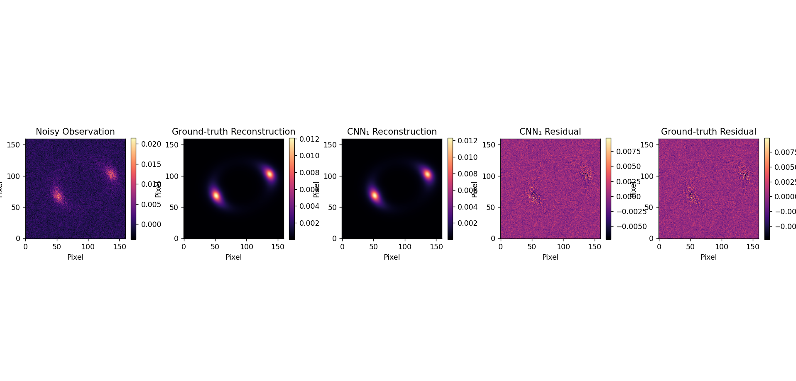

# Olin

### Scientific Machine Learning for Inverse Inference in Strong Gravitational Lensing

Olin is a scientific machine-learning project exploring how deep learning can estimate physical parameters of gravitational lenses from astronomical observations.

The central question is:

**If gravity bends light in a predictable way, can a neural network work backwards from an observed image and estimate the physical parameters responsible for that distortion?**

Olin investigates this question using established gravitational-lensing physics, controlled synthetic observations, convolutional neural networks, and physics-based image reconstruction.

Rather than treating an astronomical image as an ordinary classification input, Olin approaches it as the observable outcome of an underlying physical system.

### The pipeline

```text
       Physical Parameters
               |
               v
       Gravitational Lensing
               |
               v
       Synthetic Observations
               |
               v
       CNN-Based Inference
               |
               v
       Predicted Parameters
               |
               v
       Physics-Based Reconstruction
               |
               v
       Scientific Evaluation
```

The project combines three components:

- **Physics:** Generate observations using established gravitational-lensing models.
- **Deep Learning:** Infer physical parameters from generated images.
- **Reconstruction:** Use inferred parameters to reproduce observations through the physical model.

---

## Project Status

**Active Development — Synthetic Inference and Reconstruction Pipeline**

Olin currently has a working synthetic observation generation, parameter inference, and reconstruction pipeline.

### Completed

- First-principles gravitational-lensing sandbox
- Point-mass lensing and Einstein-radius calculations
- Extended-source modelling
- Distributed-mass lensing experiments
- Singular Isothermal Ellipsoid (SIE) lens model
- Elliptical Sérsic source model
- External shear
- Point Spread Function (PSF) modelling
- Photon-counting noise and detector read-noise simulation
- FM1 synthetic observation generator
- Dataset V0 containing 10,000 labelled observations
- Dataset preparation and normalization pipeline
- CNN₀ baseline regression model
- CNN₁ improved regression model
- Quantitative CNN₀ vs CNN₁ evaluation
- Parameter-wise prediction error analysis
- FM2 physics-based reconstruction engine
- CNN₁-to-FM2 inference and reconstruction integration

### Current Development

- Quantitative reconstruction residual analysis
- Scientific validation of inferred parameters
- Investigation of parameter degeneracies
- Generalization testing under increased physical variation

### Planned

- Uncertainty estimation
- More realistic lens and source variations
- Out-of-distribution evaluation
- Validation using real astronomical observations
- Automated scientific reporting
- Web application

> **Scope clarification:** Olin is currently a controlled synthetic experiment. Its results demonstrate performance within the simulated parameter space. It has not yet been validated on real astronomical observations.

---

# 1. Scientific Background

## 1.1 What is gravitational lensing?

Imagine observing a distant galaxy.

Between that galaxy and the observer, there may be another massive object, such as a foreground galaxy or galaxy cluster.

The gravitational field of this foreground object bends the path of light travelling from the distant source towards us.

This phenomenon is called **gravitational lensing**.

In strong gravitational lensing, the deflection can be substantial enough to produce structures such as:

- Einstein rings
- Curved arcs
- Multiple images of the same background source

The resulting image contains information about the foreground mass distribution responsible for the distortion.

<details>
<summary>Why is this useful in astrophysics?</summary>

The total mass of a foreground object is not always directly revealed by its visible light.

However, its gravitational influence affects the paths of photons travelling from background sources.

By studying the distortion of those background images, astronomers can investigate the mass distribution of the foreground lens.

This makes gravitational lensing an important tool in astrophysics and cosmology.

</details>

## 1.2 Understanding the lens equation

The relationship between the source position, observed image position, and gravitational deflection is described by the gravitational-lensing equation:

$$
\boldsymbol{\beta}
=
\boldsymbol{\theta}
-
\boldsymbol{\alpha}(\boldsymbol{\theta})
$$

Where:

| Symbol | Meaning |
|---|---|
| β | Position of the source in the source plane |
| θ | Position of the image in the image plane |
| α | Gravitational deflection angle |

In simpler terms:

- Light originates from a background source.
- The foreground gravitational field changes its propagation direction.
- The observer receives light at an apparent image position.
- The difference between the source and image positions is related to gravitational deflection.

The lens equation provides the mathematical foundation for the physical forward model used in Olin.

## 1.3 The forward problem and inverse problem

There are two ways to approach gravitational-lensing modelling.

### Forward problem

Suppose the physical system is already known:

- The foreground lens mass distribution
- The background source brightness distribution
- The geometry of the lensing system

Can we calculate what the resulting image should look like?

That is the forward problem.

```text
Known Lens Parameters
          +
Known Source Parameters
          |
          v
   Gravitational-Lensing Model
          |
          v
      Predicted Image
```

### Inverse problem

Now consider the opposite situation.

We have an observed gravitational-lensing image, but we do not know all the physical parameters that produced it.

Can we estimate those parameters from the image?

```text
    Observed Image
          |
          v
  Parameter Estimation
          |
          v
  Inferred Physical Parameters
```

This is the inverse problem.

It is more challenging because different physical configurations can sometimes produce similar-looking observations.

This is known as **parameter degeneracy**.

Olin investigates this inverse problem using deep learning.

## 1.4 Initial inference target: Einstein radius

The first version of Olin focuses on estimating the Einstein radius, represented by θ_E.

The Einstein radius characterizes the angular scale of a gravitational lens. It depends on the lens mass and the geometry between the observer, lens, and source.

For a simple point-mass lens, the Einstein radius is:

$$
\theta_E
=
\sqrt{
\frac{4GM}{c^2}
\frac{D_{LS}}{D_LD_S}
}
$$

Where:

- G is the gravitational constant.
- M is the lens mass.
- c is the speed of light.
- D_L is the angular-diameter distance to the lens.
- D_S is the angular-diameter distance to the source.
- D_LS is the angular-diameter distance between the lens and source.

This expression illustrates why the Einstein radius is physically meaningful: it is connected to both the lens mass and the geometry of the system.

For the initial machine-learning experiment, Olin treats θ_E as a continuous regression target.

```text
Input:
A 160 × 160 synthetic gravitational-lensing image

Output:
Predicted Einstein radius (θ_E)
```

Only the Einstein radius varies across Dataset V0. Other lens, source, and observational parameters remain fixed.

This controlled setup isolates the relationship between image morphology and the target parameter before introducing additional physical variation.

**Olin does not attempt to introduce new gravitational-lensing physics.** It uses established physical models to investigate a scientific inverse-inference problem.

---

# 2. Physical Forward Model — FM1

FM1 is responsible for generating synthetic astronomical observations from known physical parameters.

It uses established gravitational-lensing modelling through [lenstronomy](https://github.com/lenstronomy/lenstronomy).

The purpose of FM1 is to create observations for which the underlying physical parameters are already known.

These known parameters become the ground-truth labels used during machine-learning training and evaluation.

## 2.1 Observation generation pipeline

An ideal gravitational-lensing image is not identical to an image recorded by an astronomical instrument.

The instrument and detection process introduce additional effects, such as image blurring and noise.

Olin incorporates several of these effects in a controlled observation model.

```text
       Lens Parameters
              +
       Source Parameters
              |
              v
      Gravitational Lensing
              |
              v
        Ideal Lensed Image
              |
              v
       Observation Modelling
              |
              v
       Point Spread Function
              |
              v
        Photon-Counting Noise
              |
              v
          Read Noise
              |
              v
       Synthetic Observation
```

## 2.2 Physical configuration

### Lens model

Olin uses a Singular Isothermal Ellipsoid (SIE) with external shear.

The lens configuration includes:

- Einstein radius
- Ellipticity parameters
- External shear components
- Lens centre coordinates

The current configuration is defined using:

```python
make_lens_kwargs(
    theta_E=1.6,
    e1=0.15,
    e2=0.0,
    gamma1=0.15,
    gamma2=0.15,
    center_x=0,
    center_y=0
)
```

### Source model

The background source is represented using an elliptical Sérsic brightness profile.

Its configuration includes:

- Amplitude: 1.0
- Effective radius: 0.3
- Sérsic index: 2.0
- Ellipticity parameters: 0, 0
- Source centre: (0.6, 0.3)

The Sérsic profile provides a parameterized way to describe the brightness distribution of an extended astronomical source.

### Observation configuration

| Parameter | Value |
|---|---|
| Image dimensions | 160 × 160 pixels |
| Pixel scale | 0.05 arcsec/pixel |
| Field of view | 8 × 8 arcsec |
| PSF | Gaussian |
| PSF FWHM | 0.4 arcsec |
| Photon scale | 1000 |
| Read noise | 1.0 |

### Understanding the observational effects

| Component | Purpose |
|---|---|
| PSF | Models how the instrument blurs incoming light |
| Photon-counting noise | Represents statistical fluctuations in detected photons |
| Read noise | Represents additional noise introduced by detector electronics |

The observation model is intentionally controlled. It is not a complete telescope or detector simulator.

The objective is to introduce relevant observational effects while keeping the initial inverse problem manageable.

**FM1 implementation:** `FM1/dataset_generation_forward_model.py`

---

# 3. Synthetic Dataset — Dataset V0

A major advantage of synthetic data is that the physical parameters used to generate each observation are known.

For example, if FM1 generates an image using an Einstein radius of 2.1 arcseconds, the corresponding ground-truth label is also 2.1 arcseconds.

This allows the network's predictions to be compared directly against known values.

## 3.1 Dataset configuration

Dataset V0 contains **10,000 synthetic gravitational-lensing observations**.

| Parameter | Configuration |
|---|---|
| Target | Einstein radius (θ_E) |
| Target range | 1.6″ – 2.8″ |
| Image dimensions | 160 × 160 |
| Pixel scale | 0.05″ / pixel |
| Field of view | 8 × 8 arcsec |
| Lens model | SIE + external shear |
| Source model | Elliptical Sérsic |
| PSF | Gaussian |
| Total samples | 10,000 |
| Training samples | 8,000 |
| Validation samples | 1,000 |
| Test samples | 1,000 |

The initial Einstein-radius range was selected after examining the generated observations and ensuring that the lensing structures remained sufficiently distinguishable for the controlled V0 experiment.

## 3.2 Dataset structure

```text
datasets/
└── dataset_v0/
    ├── images/
    │   ├── 000001.npy
    │   ├── 000002.npy
    │   └── ...
    ├── labels.csv
    └── metadata.json
```

`labels.csv` stores the image identifiers and corresponding Einstein-radius values.

`metadata.json` stores the normalization statistics:

| Statistic | Value |
|---|---:|
| Mean | 0.0003863187987299882 |
| Standard deviation | 0.0016383269836459237 |

Each generated image is stored as a NumPy array.

## 3.3 Dataset preparation

The preparation pipeline performs the following operations:

1. Loads the generated images and their labels.
2. Shuffles the samples using a fixed random seed.
3. Splits the samples into training, validation, and test sets.
4. Calculates normalization statistics using the training set only.
5. Applies the same normalization to all three sets.
6. Saves the prepared arrays for model training.

The split is reproducible:

```python
rng = np.random.default_rng(42)
rng.shuffle(samples)
```

The training set contains 8,000 samples, while validation and test each contain 1,000.

Normalization statistics are calculated from the training set to avoid using information from the validation or test sets during preprocessing.

Generated images and prepared arrays are excluded from Git because they are derived experimental data.

**Dataset preparation:** `training/prepare_dataset.py`

---

# 4. Machine-Learning Pipeline

Olin uses convolutional neural networks (CNNs) to estimate the Einstein radius from synthetic gravitational-lensing images.

## 4.1 Why convolutional neural networks?

A gravitational-lensing observation contains spatial structures:

- Curved arcs
- Ring-like patterns
- Brightness distributions
- Changes in image morphology

A convolutional neural network learns spatial features from an image through convolutional filters.

Instead of manually defining every feature, the model learns representations that are useful for predicting the target parameter.

Olin currently uses two model versions: CNN₀ and CNN₁.

## 4.2 CNN₀ — Baseline Model

CNN₀ establishes the initial regression baseline.

Its purpose was to determine whether a relatively simple CNN could learn a relationship between the simulated image morphology and the Einstein radius.

### Architecture

```text
Input: 160 × 160 × 1
          |
          v
Conv2D — 16 filters, 3 × 3, ReLU
          |
          v
MaxPooling — 2 × 2
          |
          v
Conv2D — 32 filters, 3 × 3, ReLU
          |
          v
MaxPooling — 2 × 2
          |
          v
Flatten
          |
          v
Dense — 64, ReLU
          |
          v
Dense — 1
          |
          v
Predicted Einstein Radius
```

The model contains approximately **2.96 million trainable parameters**.

### Training configuration

| Setting | Value |
|---|---|
| Optimizer | Adam |
| Loss function | Mean Squared Error |
| Evaluation metric | Mean Absolute Error |
| Epochs | 10 |
| Batch size | 32 |
| Random seed | 42 |
| Input | Normalized grayscale image |
| Output | Einstein radius |

CNN₀ demonstrated that the network could learn a relationship between the image and the target parameter.

However, its validation performance deteriorated after the early training epochs under the fixed training schedule.

It therefore serves as the baseline for evaluating the improved training approach.

## 4.3 CNN₁ — Improved Regression Model

CNN₁ introduces improved training control and validation monitoring.

The objective was to address the training limitations observed in CNN₀ and obtain more reliable parameter estimates.

The training pipeline incorporates:

- Validation-based monitoring
- Early stopping
- Improved training evaluation

CNN₁ achieved substantially better performance on the held-out test set.

---

# 5. Experimental Evaluation — CNN₀ vs CNN₁

Both models were evaluated on the same held-out test set.

Two metrics are used.

### Mean Absolute Error (MAE)

MAE measures the average absolute difference between predicted and true Einstein-radius values.

$$
MAE =
\frac{1}{N}
\sum_{i=1}^{N}
|y_i-\hat{y}_i|
$$

Here:

- yᵢ is the ground-truth value.
- ŷᵢ is the model prediction.
- N is the number of test samples.

A lower MAE indicates that predictions are closer to their corresponding ground-truth values on average.

### Mean Squared Error (MSE)

MSE measures the average squared prediction error.

$$
MSE =
\frac{1}{N}
\sum_{i=1}^{N}
(y_i-\hat{y}_i)^2
$$

Squaring the errors gives larger deviations more influence on the metric.

## 5.1 Test results

| Metric | CNN₀ | CNN₁ |
|---|---:|---:|
| Test MAE | 0.111396″ | **0.019245″** |
| Test MSE | 0.01388 | **0.00057045** |

CNN₁ achieved approximately **82.7% lower test MAE** than CNN₀.

Equivalently, its test MAE was approximately **5.8 times lower**.

## 5.2 CNN₁ training behaviour

| Measurement | Result |
|---|---:|
| Best validation MAE | 0.018489″ |
| Best validation epoch | 9 |
| Early stopping | Epoch 14 |

CNN₁ also outperformed CNN₀ across the tested Einstein-radius bins.

The observed prediction behaviour showed:

- CNN₀ had a systematic tendency to overestimate.
- CNN₁ showed a slight negative bias.

These results indicate that the improved training approach produced substantially more accurate parameter estimates within the current synthetic test distribution.

### Interpretation and limitations

The improvement is encouraging, but it should be interpreted within the scope of Dataset V0.

The models have been evaluated under a restricted physical configuration in which the Einstein radius varies while the remaining physical parameters are held fixed.

Therefore, these results do not establish that CNN₁ can reliably infer Einstein radii from arbitrary astronomical observations.

The next scientific challenge is to investigate how inference behaves when additional physical parameters vary and when different configurations produce similar observations.

### Evaluation artifacts

```text
training/
└── results/
    └── cnn_1/
        ├── history.json
        ├── metrics.json
        ├── cnn_1_learning_curves.png
        └── test_error_analysis.png
```

### Experiment report

[Experiment 1 — CNN₀ vs CNN₁](Documents%20and%20updations/Experiment%20Reports/Experiment_1_CNN0_vs_CNN1.pdf)

---

# 6. Physics-Based Reverse Reconstruction — FM2

A successful parameter prediction is not necessarily the end of a scientific inverse-inference experiment.

Suppose CNN₁ receives a gravitational-lensing observation and predicts an Einstein radius.

How can we investigate whether that inferred parameter produces a physically consistent image?

One approach is to pass the predicted parameter back into the original physical forward model and reconstruct the observation.

This is the purpose of **FM2**.

## 6.1 Why reconstruction?

Consider the complete process:

```text
Original Physical Parameters
             |
             v
            FM1
             |
             v
     Synthetic Observation
             |
             v
            CNN₁
             |
             v
     Predicted Einstein Radius
             |
             v
            FM2
             |
             v
     Reconstructed Observation
```

FM1 generates the original synthetic observation.

CNN₁ estimates its Einstein radius.

FM2 then uses the predicted Einstein radius to render a reconstructed image through the established physical forward model.

This closes the inference-and-reconstruction loop.

## 6.2 FM2 implementation

FM2 reuses the Lenstronomy-based physical configuration established in FM1.

It does not introduce a second neural network for image reconstruction.

Instead, it uses the inferred physical parameter to render a new image through the physical model.

An important implementation detail is that FM2 calls:

```python
image_model.image(...)
```

rather than using the full stochastic observation simulation.

This produces a deterministic model image without introducing a fresh realization of detector noise.

The result can therefore be compared more directly with the original noisy observation.

### Two reconstruction paths

FM2 generates two reconstructions.

**1. Ground-truth reconstruction**

Uses the actual Einstein radius associated with the synthetic observation.

**2. CNN₁-predicted reconstruction**

Uses the Einstein radius estimated by CNN₁.

The ground-truth reconstruction acts as a control.

It helps separate errors caused by the CNN's parameter prediction from differences caused by the forward-model reconstruction process itself.

## 6.3 Residual analysis

The difference between an observed image and a reconstructed image is called the residual.

$$
R =
I_{\mathrm{observed}}
-
I_{\mathrm{reconstructed}}
$$

Where:

- I_observed is the original synthetic observation.
- I_reconstructed is the image generated by FM2.
- R is the residual image.

A residual image shows which structures in the original observation are not reproduced by the reconstruction.

A smaller residual can indicate closer image agreement.

However, **a small residual alone does not prove that the inferred physical parameters are correct**.

Different parameter configurations can sometimes produce similar observations. This is why reconstruction quality must be considered alongside direct parameter error.

## 6.4 CNN₁ → FM2 integration

The integration between CNN₁ and FM2 is operational across two Python environments.

| Environment | Responsibility |
|---|---|
| WSL — `olin-tf` | TensorFlow/Keras model inference |
| Windows PowerShell | Lenstronomy-based reconstruction |

The environment separation is intentional.

The TensorFlow/Keras model is loaded and executed in WSL, while the Lenstronomy reconstruction is performed in the Windows environment.

The intermediate prediction is transferred through a NumPy archive containing:

- Image identifier
- Ground-truth Einstein radius
- CNN₁-predicted Einstein radius
- Original observed image

This allows both environments to participate in the same inference-and-reconstruction workflow.

## 6.5 Initial integration test

One held-out synthetic observation was used to verify the complete bridge.

| Measurement | Value |
|---|---:|
| Image ID | 9212 |
| Ground-truth θ_E | 2.05697165″ |
| CNN₁ prediction | 2.02983451″ |
| Absolute prediction error | 0.02713714″ |
| Relative prediction error | Approximately 1.32% |

The FM2 renderer successfully generated a reconstructed image with dimensions of 160 × 160 pixels.

The rendered output was also checked for numerical validity, with no NaN or infinite values detected.

This confirms that the CNN₁ prediction can be transferred into the physical reconstruction model.

It is an integration test, not yet a systematic reconstruction validation across the complete test set.

## 6.6 Reconstruction visualization

The following figure shows the current five-panel FM2 comparison.



*Five-panel comparison of the original noisy synthetic observation, ground-truth reconstruction, CNN₁-predicted reconstruction, and the corresponding residual maps.*

The panels illustrate:

1. **Observed image:** The original noisy synthetic observation generated by FM1.
2. **Ground-truth reconstruction:** The deterministic reconstruction using the actual Einstein radius.
3. **CNN₁ reconstruction:** The reconstruction using the Einstein radius predicted by CNN₁.
4. **CNN₁ residual:** The difference between the observed image and the CNN₁-guided reconstruction.
5. **Ground-truth residual:** The difference between the observed image and the ground-truth reconstruction.

This comparison is useful because it provides two distinct references:

- How well can the forward model reproduce the observation when supplied with the correct Einstein radius?
- How does the reconstruction change when the physical parameter is supplied by the neural network instead?

The figure demonstrates the current reconstruction workflow qualitatively.

Systematic residual statistics, broader test-set reconstruction evaluation, and investigation of parameter degeneracies remain ongoing.

**FM2 implementation:** `FM2/reverse_reconstruction_model.py`

**Integration test:** `FM2/test_cnn1_fm2.py`

---

# 7. Complete Olin Workflow

The current pipeline connects physical simulation, machine learning, and reverse reconstruction.

```text
       PHYSICAL MODELLING
               |
               v
       Physical Parameters
               |
               v
              FM1
               |
               v
     Synthetic Dataset V0
          (10,000 images)
               |
               v
       Dataset Preparation
               |
               v
        Train / Validation / Test
               |
        +------+------+
        |             |
        v             v
      CNN₀           CNN₁
        |             |
        v             v
    Baseline      Improved Inference
    Evaluation         |
                       v
              Predicted Einstein Radius
                       |
                       v
                      FM2
                       |
                       v
              Reconstructed Image
                       |
                       v
               Residual Analysis
                       |
                       v
             Scientific Evaluation
```

CNN₀ provides the baseline comparison, while CNN₁ supplies the current parameter predictions used by FM2.

| Component | Responsibility |
|---|---|
| FM1 | Generate synthetic observations from known physical parameters |
| Dataset pipeline | Prepare labelled data for training and evaluation |
| CNN₀ | Establish a baseline regression result |
| CNN₁ | Perform improved Einstein-radius inference |
| FM2 | Reconstruct an observation using supplied physical parameters |
| Evaluation | Compare predictions and reconstructed observations |

---

# 8. Repository Structure

The repository is organized around the scientific and computational stages of the project.

```text
Olin/
│
├── assets/
│   └── fm2_reconstruction.png
│
├── simulation/
│   ├── point_mass.py
│   ├── einstein_ring.py
│   ├── extended_source.py
│   ├── distributed_mass.py
│   ├── sie.py
│   └── sersic.py
│
├── FM1/
│   ├── dataset_generation_forward_model.py
│   ├── generate_dataset.py
│   └── README.md
│
├── FM2/
│   ├── reverse_reconstruction_model.py
│   └── test_cnn1_fm2.py
│
├── training/
│   ├── prepare_dataset.py
│   ├── train_cnn_0.py
│   ├── train_cnn_1.py
│   ├── analyze_cnn_1_bins.py
│   ├── analyze_cnn_1_errors.py
│   ├── plot_cnn_1_evaluation.py
│   │
│   └── results/
│       └── cnn_1/
│           ├── history.json
│           ├── metrics.json
│           ├── cnn_1_learning_curves.png
│           └── test_error_analysis.png
│
├── datasets/                       # Generated data, excluded from Git
│
├── Documents and updations/
│   ├── Olin_scientific_sw_report.pdf
│   └── Experiment Reports/
│       └── Experiment_1_CNN0_vs_CNN1.pdf
│
├── README.md
└── .gitignore
```

Generated datasets, prepared arrays, model weights, and temporary prediction files are excluded from version control.

---

# 9. Scientific Design Principles

Olin follows several principles to keep the scientific and software components meaningful.

### 1. Physics before machine learning

Synthetic observations are generated using established gravitational-lensing models.

The neural network learns from a controlled physical system rather than arbitrary image labels.

### 2. Ground truth matters

Every synthetic observation has known physical parameters.

This makes it possible to evaluate parameter predictions quantitatively.

### 3. Reconstruction complements prediction

Predicting a parameter is only one part of the inverse problem.

Passing that parameter back through the physical model provides another way to examine the inference result.

### 4. Controlled experiments before complexity

The initial dataset varies only one target parameter.

Additional physical variation will be introduced progressively so that the effects of individual modelling decisions can be studied.

### 5. Separate scientific responsibilities

FM1, the CNN models, and FM2 have distinct responsibilities.

This keeps the physical observation generator separate from parameter inference and reconstruction.

### 6. Avoid unsupported scientific claims

Olin is an engineering and scientific ML investigation built around established gravitational-lensing physics.

Its current results should not be interpreted as new cosmological discoveries or validated real-observation measurements.

---

# 10. Future Development

The next stages focus on improving scientific reliability rather than simply increasing model complexity.

## 10.1 Physical modelling

- Introduce additional lens configurations.
- Explore variations in source morphology.
- Investigate the effects of varying multiple physical parameters.
- Study parameter degeneracies.
- Introduce more realistic observational effects.

## 10.2 Machine learning

- Investigate uncertainty estimation.
- Evaluate reliability under increased physical variation.
- Perform out-of-distribution testing.
- Examine the effects of parameter degeneracy on inference.
- Compare model performance under different dataset configurations.

## 10.3 Reconstruction and validation

- Perform systematic residual analysis.
- Quantify reconstruction quality across the test set.
- Compare predicted-parameter and ground-truth reconstructions.
- Separate parameter-estimation errors from forward-model limitations.
- Investigate reconstruction behaviour under physical degeneracies.
- Eventually evaluate the system using real astronomical observations.

## 10.4 Software development

- Develop automated scientific reports.
- Build a web interface for submitting observations and viewing results.
- Store experiment metadata and inference results.
- Improve reproducibility and deployment.

The priority is to develop a scientifically meaningful inverse-inference system rather than adding software features without a clear purpose.

---

# 11. Technologies

| Area | Technologies |
|---|---|
| Programming language | Python |
| Numerical computation | NumPy |
| Data handling | Pandas |
| Scientific visualization | Matplotlib |
| Gravitational-lens modelling | lenstronomy |
| Deep learning | TensorFlow / Keras |
| Data storage | NumPy arrays, CSV, JSON |
| Version control | Git and GitHub |

### Planned application technologies

| Component | Planned technology |
|---|---|
| Backend | FastAPI |
| Database | PostgreSQL |
| Frontend | HTML, CSS, JavaScript |
| Reporting | PDF generation |

These application components are planned extensions and are not part of the completed scientific pipeline.

---

# 12. Documentation and Reports

The project maintains separate documentation for the overall scientific software design and individual experiments.

- [Olin Scientific Software Report](Documents%20and%20updations/Olin_scientific_sw_report.pdf)
- [Experiment 1 — CNN₀ vs CNN₁](Documents%20and%20updations/Experiment%20Reports/Experiment_1_CNN0_vs_CNN1.pdf)

The experiment report documents the baseline comparison and quantitative evaluation of CNN₀ and CNN₁.

---

# 13. References

The project builds upon established gravitational-lensing theory and existing scientific software.

1. Birrer, S., & Amara, A. (2018). *lenstronomy: Multi-purpose gravitational lens modelling software package.* Physics of the Dark Universe, 22, 189–201.  
   https://doi.org/10.1016/j.dark.2018.11.002

2. Birrer, S. et al. (2021). *lenstronomy II: A gravitational lensing software ecosystem.* Journal of Open Source Software.

3. Birrer, S. (2024). *Strong gravitational lensing's 'external shear' is not shear.* Monthly Notices of the Royal Astronomical Society.

4. [lenstronomy — GitHub Repository](https://github.com/lenstronomy/lenstronomy)

---

## Olin

**Connecting gravitational-lensing physics with machine-learning inverse inference.**
