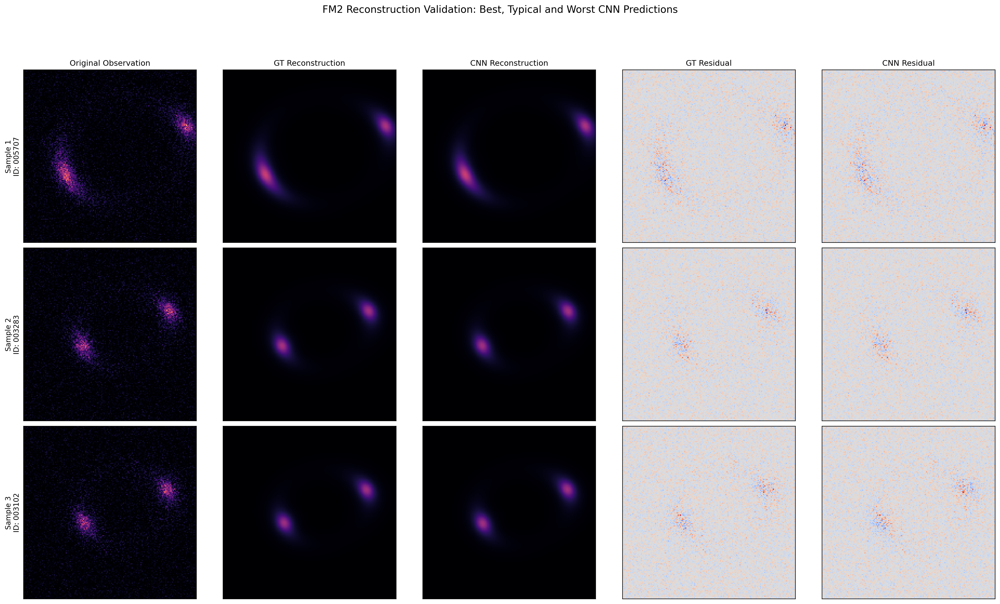

# Olin — Dataset V0: Reconstruction Validation

## 1. Objective

The objective of this experiment is to validate the integration between Olin's CNN-based parameter inference model (CNN₁) and its physics-based reconstruction engine (FM2).

CNN₁ predicts the Einstein radius (\(\theta_E\)) from a synthetic gravitational-lensing observation. FM2 receives this predicted parameter and generates a reconstructed image using the established forward model.

The experiment investigates whether the inferred parameter produces a reconstruction comparable to one generated using the original ground-truth parameter.

## 2. Validation Methodology

A stratified subset of 30 observations was selected from the held-out test dataset.

The samples were distributed across five equal-width Einstein-radius bins, with six samples selected from each bin.

For every observation, two reconstructions were generated:

- **Ground-truth reconstruction:** Uses the original Einstein radius used during synthetic observation generation.
- **CNN reconstruction:** Uses the Einstein radius predicted by CNN₁.

Both reconstructions were compared against the same original noisy observation.

### Reconstruction pipeline

Original Observation → CNN₁ → Predicted Einstein Radius → FM2 → Reconstructed Image → Residual Analysis

The reconstruction engine uses deterministic image rendering. No additional detector noise is introduced during reconstruction.

## 3. Evaluation Metrics

### Parameter estimation error

The absolute Einstein-radius prediction error is:

\[
E_{\theta} = |\theta_{E,\mathrm{predicted}}-\theta_{E,\mathrm{true}}|
\]

### Pixel reconstruction error

For an observed image \(I_{\mathrm{obs}}\) and reconstructed image \(I_{\mathrm{rec}}\), the residual is:

\[
R(x,y)=I_{\mathrm{obs}}(x,y)-I_{\mathrm{rec}}(x,y)
\]

Mean Absolute Error (MAE):

\[
MAE=\frac{1}{N}\sum_{i=1}^{N}|R_i|
\]

Root Mean Squared Error (RMSE):

\[
RMSE=\sqrt{\frac{1}{N}\sum_{i=1}^{N}R_i^2}
\]

These metrics quantify pixel-level differences between the original observation and each reconstruction.

## 4. Quantitative Results

### Parameter estimation

| Metric | Result |
|---|---:|
| Validation samples | 30 |
| Mean absolute parameter error | 0.017951 arcsec |
| Median absolute parameter error | 0.014763 arcsec |

### Reconstruction comparison

| Metric | Ground-truth reconstruction | CNN reconstruction |
|---|---:|---:|
| Mean MAE | 0.00090402 | 0.00090494 |
| Mean RMSE | 0.00117784 | 0.00118010 |

The CNN-based reconstructions produced slightly higher average pixel residuals than the ground-truth reconstructions.

The differences were approximately 0.10% for MAE and 0.19% for RMSE.

This indicates that, for the selected observations, using CNN₁-predicted Einstein radii produced reconstructions with pixel residuals close to those obtained using the ground-truth parameters.

## 5. Qualitative Reconstruction Analysis

Three representative observations were selected:

| Sample | Image ID | Absolute parameter error |
|---|---|---:|
| Best | 005707 | 0.00064 arcsec |
| Typical | 003283 | 0.01446 arcsec |
| Worst | 003102 | 0.05328 arcsec |

For each observation, five panels were examined:

1. Original noisy observation.
2. Ground-truth reconstruction.
3. CNN-predicted reconstruction.
4. Ground-truth reconstruction residual.
5. CNN reconstruction residual.

The comparisons show that the reconstructed image morphology remains visually similar even for the sample with the largest parameter error.

The visual comparison complements the quantitative parameter and residual measurements.

### Visualization

## 6. Interpretation

The experiment demonstrates that CNN₁ predictions can be transferred into FM2 and used to generate physics-based reconstructions.

The small difference between ground-truth and CNN reconstruction residuals indicates that the inferred Einstein radii produce similar image-level results for the selected test observations.

However, pixel residuals must not be interpreted as direct proof of physical parameter correctness.

The original observations contain simulated noise, whereas FM2 produces clean deterministic model images. Consequently, residuals include observational noise and differences between the observation and the reconstruction.

A reconstruction with a lower pixel residual does not necessarily imply a more accurate physical parameter.

Direct parameter-error evaluation therefore remains essential.

## 7. Limitations

This experiment has several limitations:

- Validation was performed on 30 stratified observations rather than the complete test set.
- The experiment focuses on a single inferred physical parameter: the Einstein radius.
- Most lens, source and observational parameters remain fixed.
- The synthetic observations are generated using a controlled simulation configuration.
- Real astronomical observations and their associated instrumental and modelling complexities have not yet been evaluated.
- The experiment does not establish performance under parameter degeneracies or out-of-distribution conditions.

The results should therefore be interpreted as an integration and validation check for the controlled synthetic V0 pipeline, not as evidence of general-purpose astronomical parameter estimation.

## 8. Conclusion

The Dataset V0 inference and reconstruction pipeline has been successfully integrated and evaluated.

CNN₁ predicts the Einstein radius from synthetic observations, and FM2 uses these predictions to generate corresponding physics-based reconstructions.

Quantitative parameter errors, reconstruction residuals and representative visual comparisons provide evidence that the pipeline operates as intended under the controlled V0 configuration.

This completes the core synthetic inference and reconstruction milestone for Dataset V0.

## 9. Transition to Dataset V1

The next development stage will focus on improving the scientific realism and diversity of the forward simulator.

Planned areas of investigation include:

- More varied lens and source configurations.
- Additional physically meaningful parameter variation.
- Observational effects and their influence on inference.
- Appropriate dataset parameter ranges.
- Validation experiments designed to evaluate generalization and parameter ambiguity.

The objective of V1 is to move beyond the controlled single-parameter experiment and investigate a more challenging gravitational-lensing inverse-inference problem.